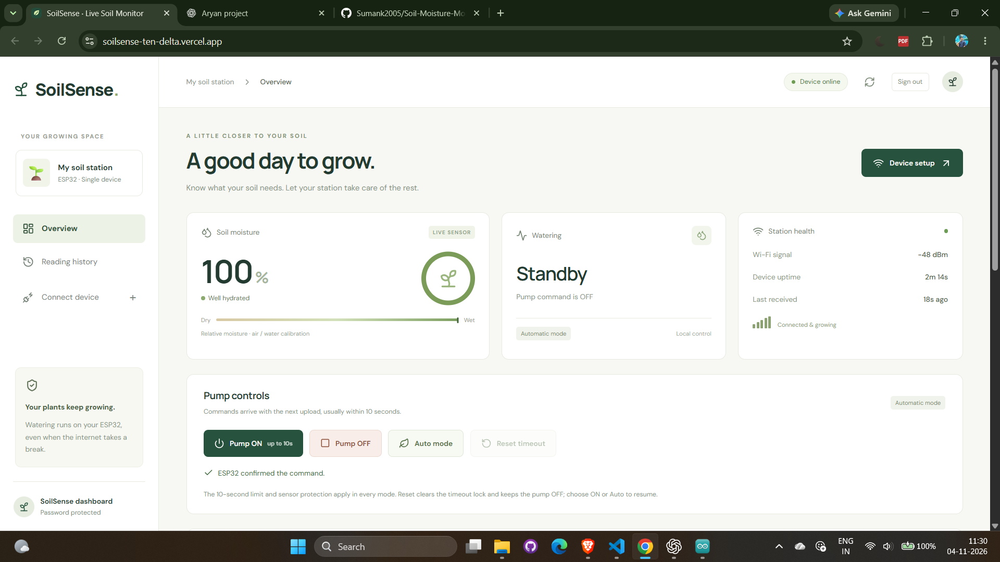
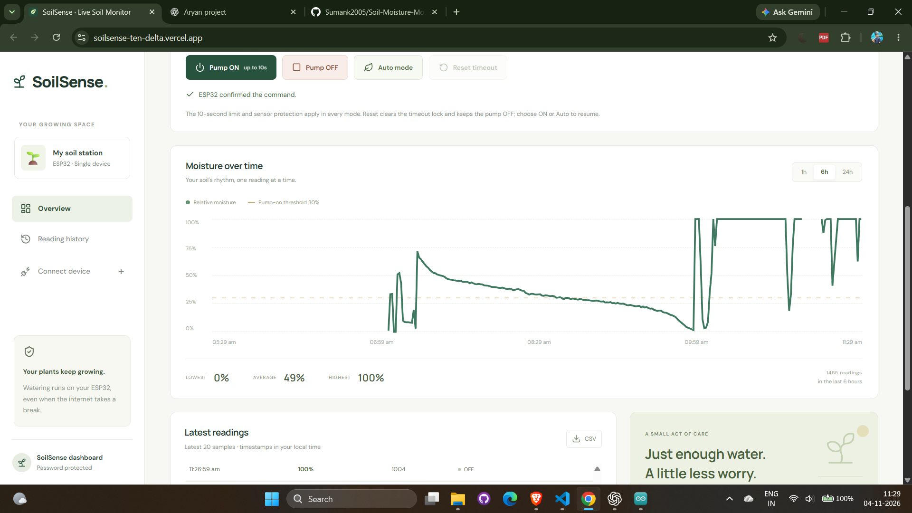

# SoilSense

ESP32 soil moisture monitoring and irrigation dashboard with live readings, reading history, and online pump controls.

**Live application:** [Open SoilSense](https://soilsense-ten-delta.vercel.app/)

## Screenshots

### Dashboard and pump controls



### Moisture history and recent readings



## Local development

Two independent applications. Each has its own package.json, package-lock.json, node_modules, environment configuration and deployment instructions. There is no root npm project or shared environment file.

| Project | Local address | Instructions |
| --- | --- | --- |
| React TSX frontend | http://localhost:5173 | [frontend/README.md](frontend/README.md) |
| Express + Neon backend | http://localhost:3001 | [backend/README.md](backend/README.md) |

Start them in two terminals:

```sh
# Terminal 1
cd backend
npm install
npm run dev
```

```sh
# Terminal 2
cd frontend
npm install
npm run dev
```

Sign in using DASHBOARD_PASSWORD in **backend/.env**. Existing local credentials were preserved. The frontend uses **frontend/.env.local** only for its public VITE_API_URL. Dashboard sessions use Bearer tokens, so sign-in works across separate frontend/backend hosts without relying on shared cookies. Backend connection and sign-in failures are displayed on the login screen.

For separate deployments, set the hosting root to **frontend** for the web project and **backend** for the API service. Follow each folder's README. The frontend builds to frontend/dist; the backend starts with npm start and never serves the frontend.

## ESP32

The configured sketch is **firmware/SoilSense_ESP32/SoilSense_ESP32.ino**. The root config.h preserves your Wi-Fi credentials and points directly to **https://soilsense-gz6h.onrender.com/api/ingest**. Device uploads go to Render over verified HTTPS and operate independently of the frontend and local computer. ESP32 needs internet access. The dashboard is deployed at **https://soilsense-ten-delta.vercel.app**. Upload the regenerated matching firmware files after changing the endpoint.

If the backend address or device token changes, update **backend/.env** and run `npm run firmware:configure` from the backend directory, then upload the refreshed sketch. Root .ino/trust_roots.h files are the firmware source; the utility synchronizes the Arduino folder and frontend public downloads. Private config.h files are excluded from Git.

Local HTTP uploads do not require internet time sync. Hosted HTTPS retains certificate verification; update trust_roots.h to match the hosting certificate authority if needed. The firmware keeps local automatic watering with the existing pins, 30%/55% hysteresis, startup delay and ten-second cutoff. The dashboard also offers Pump ON/OFF, Auto mode and Reset timeout after uploading the updated firmware once. Keep remote_control.h beside the sketch, config.h and trust_roots.h. Reset clears the timeout lock into manual OFF. Commands expire after 30 seconds and are acknowledged by the ESP. Recalibrate the sensor in actual soil.
